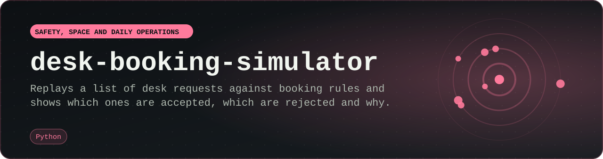
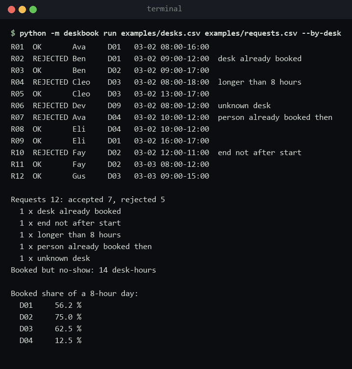

<p align="center"></p>

# desk-booking-simulator

Replays a list of desk requests against booking rules and shows which ones are accepted, which are rejected and why.



## What it is for

Hot desking means people book a desk for the day instead of owning one. Workplace managers and facility coordinators need to know how a rule such as "no booking longer than 8 hours" changes the number of conflicts and the unused desk time. This tool takes a desk list and a stream of requests, applies the rules in arrival order and prints the decision for each request. It also counts booked hours that nobody used (no-shows), which is the waste a stricter rule could remove.

## Install

```
git clone https://github.com/yassine2med/desk-booking-simulator
cd desk-booking-simulator
python -m pip install -r requirements.txt pytest
```

## How to use

| I want to | Command |
|---|---|
| Decide every request and print a summary | `python -m deskbook run DESKS.csv REQUESTS.csv` |
| Set the longest single booking (default 8 hours) | `--max-hours 4` |
| Also print the booked share of each desk | `--by-desk` |
| Change the hours in a desk day for that share (default 8) | `--day-hours 9` |

Files: `DESKS.csv` needs a `desk` column (other columns such as `zone` are ignored). `REQUESTS.csv` has `request,person,desk,start,end` with times as `YYYY-MM-DD HH:MM`, plus an optional `showed_up` column with `yes` or `no`. Samples with invented data are in `examples/`.

Worked example:

```
python -m deskbook run examples/desks.csv examples/requests.csv --by-desk
```

```
R01  OK       Ava     D01   03-02 08:00-16:00
R02  REJECTED Ben     D01   03-02 09:00-12:00  desk already booked
R03  OK       Ben     D02   03-02 09:00-17:00
R04  REJECTED Cleo    D03   03-02 08:00-18:00  longer than 8 hours
R05  OK       Cleo    D03   03-02 13:00-17:00
R06  REJECTED Dev     D09   03-02 08:00-12:00  unknown desk
R07  REJECTED Ava     D04   03-02 10:00-12:00  person already booked then
R08  OK       Eli     D04   03-02 10:00-12:00
R09  OK       Eli     D01   03-02 16:00-17:00
R10  REJECTED Fay     D02   03-02 12:00-11:00  end not after start
R11  OK       Fay     D02   03-03 08:00-12:00
R12  OK       Gus     D03   03-03 09:00-15:00

Requests 12: accepted 7, rejected 5
  1 x desk already booked
  1 x end not after start
  1 x longer than 8 hours
  1 x person already booked then
  1 x unknown desk
Booked but no-show: 14 desk-hours

Booked share of a 8-hour day:
  D01     56.2 %
  D02     75.0 %
  D03     62.5 %
  D04     12.5 %
```

## How it works

- Requests are handled one by one in file order, first come first served.
- A request is rejected for the first rule it breaks: unknown desk, end not after start, longer than the limit, desk already booked in that window, or the same person already booked in that window.
- A booking that ends exactly when another starts is not a conflict.
- Rejected requests do not hold the desk. Accepted requests do, whether or not the person showed up.
- Utilization per desk is accepted booking hours divided by the day hours times the number of days that have at least one accepted booking.

## Limits

- One fixed rule set. There is no waitlist, no recurring booking and no auto-release of no-shows.
- Bookings are not split across midnight.
- It simulates; it does not take real bookings.

## License

MIT. Copyright 2026 Yassine Emhamed.
